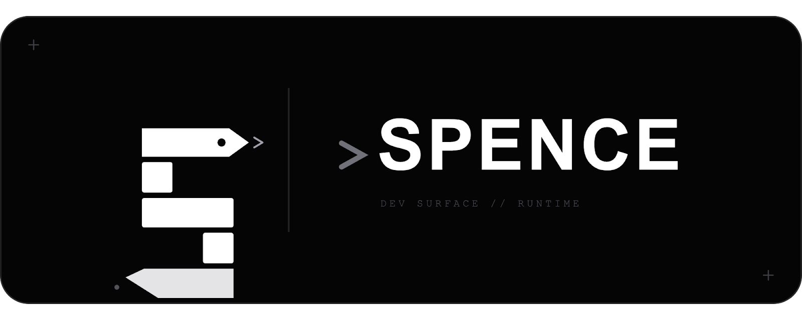

# spence



Electron desktop app with an Angular renderer, Effect for domain logic and Spartan UI (helm) components.

```
npm install
npm run dev        # renderer + electron
npm run verify     # format, types, lint, tests (the loop)
npm run e2e        # build + Playwright against the real app
```

Read `CLAUDE.md` for the map and `AGENTS.md` for the rules.
